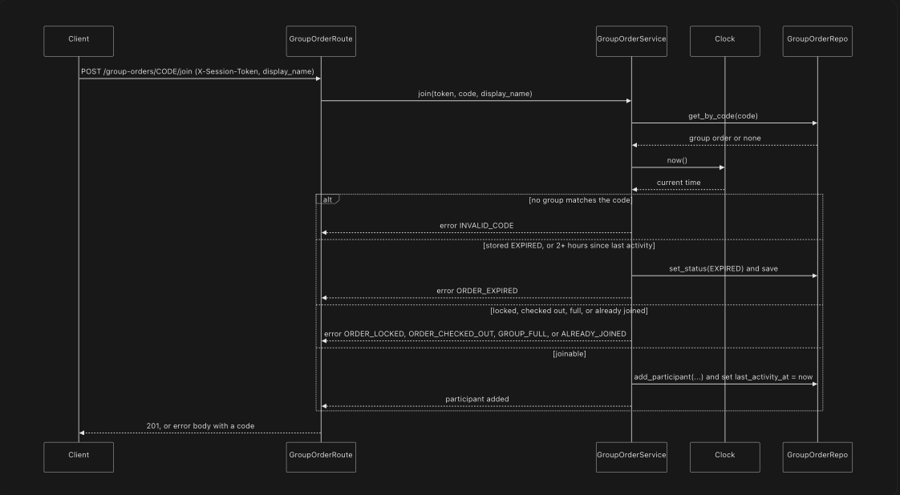

## Design: Group Order

Implements the criteria in requirements.md (R1-R39). Fits the MiniDash layers: routes -> services -> repository -> JSON file store.

Status: built, except R19 (host removes a participant) and R29 (host unlocks), which are not planned. R18 (host removes any participant's item) is built.

# Components touched

| Component (under src/) | New / Changed |
|---|---|
| routes/group_orders.py | New |
| routes/errors.py, routes/schemas.py | Changed (HTTP status for the new error codes; request models) |
| services/group_order_service.py | New |
| services/fee_split.py, services/activity_timer.py, services/share_code.py | New (small helpers with their own tests) |
| services/errors.py | Changed (constants for the new error codes) |
| repository/group_orders_repo.py | New |
| store/file_store.py | Changed (transactions can be nested; startup adds missing collections) |
| store/seed.py | Changed (adds the `sessions` and `group_orders` collections) |
| services/order_service.py | Existing, reused. Changed only by an optional `delivery_fee_cents` argument |
| main.py | Changed (builds the group order service) |
| clock.py (Clock) | Existing, injected |

Request flow: the route reads the X-Session-Token header and the request, then calls the service. The service gets the repository, the restaurant repository, the order service and the clock through its constructor. A rejected request raises a MiniDashError (its subclass EmptyParticipantError for EMPTY_PARTICIPANT), and routes/errors.py turns it into the shared error body with the right HTTP status. Routes contain no business rules.

# Data changes (JSON file store)
One JSON text file (`data.txt`) holds everything. Only the repository layer touches it, so the rest of the code does not care how data is stored. The baseline collections (restaurants, menu_items, orders, order_items) are unchanged. Two collections are added:

```json
{
    "sessions": { "<token>": { "created_at": "..." } },
    "group_orders": {
        "<code>": { // the share code is the key, so codes are unique (R5, R6)
            "code": "<code>",  // also stored inside the group
            "id": "9f2c...",  // random hex string
            "restaurant_id": 2,
            "host_token": "...",
            "status": "OPEN",    // OPEN | LOCKED | EXPIRED | CHECKED_OUT
            "last_activity_at": "...", // used by the 2-hour check (R30, R31)
            "order_id": null, // set when checked out (R36)
            "created_at": "...",
            "participants": [ // list order = join order, which decides who gets leftover cents
                { "participant_id": 1, "token": "...", "display_name": "...", "joined_at": "..." }
            ],
            "items": [
                { "participant_id": 1, "menu_item_id": 5, "quantity": 2 }
            ]
        }
    }
}
```

Rules for the file store:
- Every change is load, modify, save inside one lock, so two requests can't overwrite each other.
- A group order change is one step: `update_group_order(code, change)` loads the group, runs the checks and the change, and saves, all inside the lock. A rejection is returned from that step and raised after the save, which is how a new EXPIRED status survives a rejected request.
- Transactions can be nested. Checkout creates the order inside the group's update. The inner transaction shares the outer one's data, only the outermost one writes the file, and if an inner one fails its own changes are undone. Without this, the order would be lost or created twice.
- Save writes a temporary file and then replaces the real one, so a crash can't leave half a file.
- Group orders are never deleted, which is what keeps codes from being reused (R6).
- The path is injectable, so tests use a temporary file and never touch real data.
- Prices are not stored on the group order. Subtotals read the menu item price when the summary or checkout runs.
- At startup, an older data file gets any missing collection added. Existing data is never changed.
- The delivery fee is a constant, DELIVERY_FEE_CENTS = 499 ($4.99), at the top of services/group_order_service.py (R21). The 2-hour inactivity limit is the `ttl` constructor argument, which defaults to 2 hours.

# Interfaces
Group endpoints take the session in the header X-Session-Token (POST /sessions needs none). Rejected requests return {"error": { "code": "...", "message": "..."}} (R39). EMPTY_PARTICIPANT names the participants in its message.

| Endpoint | Purpose | Success | Error codes |
|---|---|---|---|
| POST /sessions | Get a session token | 201 {token} | none |
| POST /group-orders {restaurant_id, display_name} | Create, become host | 201 {code, status} | INVALID_SESSION, RESTAURANT_NOT_FOUND |
| POST /group-orders/{code}/join {display_name} | Join | 201 {participant_id, display_name, joined_at} | INVALID_SESSION, INVALID_CODE, ORDER_EXPIRED, ORDER_CHECKED_OUT, ORDER_LOCKED, ALREADY_JOINED, GROUP_FULL |
| POST /group-orders/{code}/participants/{participant_id}/items {menu_item_id, quantity} | Add an item | 201 {participant_id, menu_item_id, quantity} | INVALID_SESSION, INVALID_CODE, ORDER_EXPIRED, ORDER_CHECKED_OUT, ORDER_LOCKED, NOT_ALLOWED, INVALID_QUANTITY, ITEM_NOT_ON_MENU |
| PATCH /group-orders/{code}/participants/{participant_id}/items/{menu_item_id} {quantity} | Set the quantity of an item | 204 | the same as add, plus ITEM_NOT_IN_ORDER |
| DELETE /group-orders/{code}/participants/{participant_id}/items/{menu_item_id} | Remove an item | 204 | INVALID_SESSION, INVALID_CODE, ORDER_EXPIRED, ORDER_CHECKED_OUT, ORDER_LOCKED, NOT_ALLOWED, ITEM_NOT_ON_MENU, ITEM_NOT_IN_ORDER |
| GET /group-orders/{code}/summary | Subtotal, fee share, total per person | 200 {status, delivery_fee_cents, participants} | INVALID_SESSION, INVALID_CODE, NOT_ALLOWED |
| POST /group-orders/{code}/lock | Lock | 200 {code, status} | INVALID_SESSION, INVALID_CODE, ORDER_EXPIRED, ORDER_CHECKED_OUT, ORDER_LOCKED, NOT_HOST, EMPTY_PARTICIPANT |
| POST /group-orders/{code}/checkout {address} | Create the normal order | 201 {order_id, status, total_cents} | INVALID_SESSION, INVALID_CODE, ORDER_EXPIRED, ORDER_CHECKED_OUT, NOT_HOST, NOT_LOCKED, RESTAURANT_CLOSED, INVALID_ADDRESS |

The error codes in each row are listed in the order they are checked; the first one that applies is returned.

Who may do what:
- Anyone with a session can create a group or join one.
- A participant adds, changes and removes only their own items (participant_id must be theirs). The host may also remove any participant's item (R18), but cannot add or change them.
- Only a participant can read the summary. Reading it is not activity and writes nothing, except that an inactive group is saved as EXPIRED; the summary is then returned with status EXPIRED instead of being rejected.
- Only the host locks and checks out. Locking needs every participant to have an item (R25, R26). Locking an already locked group gives ORDER_LOCKED.
- Join, add, change, remove (including by the host) and lock count as activity and restart the 2-hour countdown (R30). Reading the summary, checkout and rejected requests do not.

HTTP statuses:
- 400: INVALID_QUANTITY, INVALID_ADDRESS, ITEM_NOT_ON_MENU
- 401: INVALID_SESSION (also for a missing or empty header)
- 403: NOT_HOST, NOT_ALLOWED
- 404: INVALID_CODE, RESTAURANT_NOT_FOUND, ITEM_NOT_IN_ORDER
- 409: GROUP_FULL, ALREADY_JOINED, ORDER_LOCKED, ORDER_EXPIRED, ORDER_CHECKED_OUT, NOT_LOCKED, EMPTY_PARTICIPANT, RESTAURANT_CLOSED
- 422 VALIDATION_ERROR: bad JSON, wrong types or missing fields, and path parameters that are not numbers. FastAPI checks these before the service runs, so a request with both a bad body and a missing token gets 422. A checkout with a missing or blank address is the exception: it reaches the service and gets INVALID_ADDRESS (400).

# Diagram: joining a group order

The EXPIRED status change is saved before the error is raised, even though the request itself is rejected. The diagram is the original design drawing and has not been redrawn; the join checks run in this order: INVALID_SESSION, INVALID_CODE, ORDER_EXPIRED, ORDER_CHECKED_OUT, ORDER_LOCKED, ALREADY_JOINED, GROUP_FULL.

# ADR-1: How to generate the share code
Context: Participants join with a code (R5,R6). It must be short enough to read out loud or type, and strangers should not be able to join someone's group by guessing.

Options considered 
1. Random 6-character code from a restricted alphabet (no 0,O,1,l,I), checked for uniqueness. 
2. Derived from the group order's id (for example, the auto-increment id turned into a short string)
3. Long random token (for example, a UUID)

Decision: Option 1, with the repository refusing to store a code that already exists, and a retry if a collision happens. As built: generate_share_code(existing_codes, rng=None) draws up to 100 codes and raises RuntimeError after that. The service checks each candidate against the stored groups, which are never deleted, so every code ever issued counts. If the repository still reports a duplicate (another request took the code a moment earlier), the service draws again, up to 10 times. 

Consequences
- Option 2 needs no uniqueness check, but codes come out in order, so anyone can try the neighbor codes and join other people's groups. That is the main reason it lost.
- Option 3 is practically unguessable, but is far too long to share by voice or text, which defeats the point of a share code.
- Option 1 costs a uniqueness check and a rare retry. The alphabet has 57 characters (62 letters and digits minus the 5 ambiguous ones), so 6 characters give 57^6, about 34 billion codes. That makes random guessing unlikely, but not impossible: there is no rate limit, which is out of scope. I accept that for this assignment. 
- Codes are never reused (R6), so an old code reports EXPIRED or CHECKED_OUT instead of landing in a new group.

Other decisions
- Expiry is a lazy check on access. Every service method that reaches a group applies R31 first (`_expire_if_inactive`), inside the group's atomic update. The summary only writes when the group actually expires. No background job. Every endpoint has a test for the expired case.
- Checkout reuses the existing order service. Identical items from different participants are merged by adding quantities, so the normal order looks like any other. The order service adds the delivery fee once to the total through its optional `delivery_fee_cents` argument, so the order total equals the sum of the summary totals. The order is created inside the same atomic update that marks the group CHECKED_OUT, so a failure leaves the group LOCKED with no order, and two checkouts at once make one order.
- Restaurant hours (R34): `opens_at` and `closes_at` are "HH:MM" strings without a timezone, so they are compared with the clock's time in UTC. A restaurant is open from opens_at up to, but not including, closes_at. Hours that run past midnight are not supported and count as always closed.
- Time is injected. The service takes a Clock; the default is real time and tests pass a fake.
- Money is integer cents anywhere.
- Session tokens come from `secrets.token_urlsafe(32)`. A token only identifies a user; there are no accounts (out of scope).
- Storage is a JSON file behind the repository.

Known limitations
- The group `id` is a random hex string, not an integer. Nothing uses it yet; the share code is the identifier.
- `display_name` is not validated, so a blank name is accepted.
- The seed hours are UTC. For someone far from UTC, checkout can fail with RESTAURANT_CLOSED at ordinary local times. A timezone field on restaurants would fix this.
- ActivityTimer starts counting when it is created, so the service builds it from a fixed clock at the stored last activity and then gives it the real clock. An optional starting time on ActivityTimer would remove this workaround.
- ITEM_NOT_IN_ORDER (changing or removing an item the participant does not have) is not in requirements.md. It was added because the requirements do not say what should happen.
